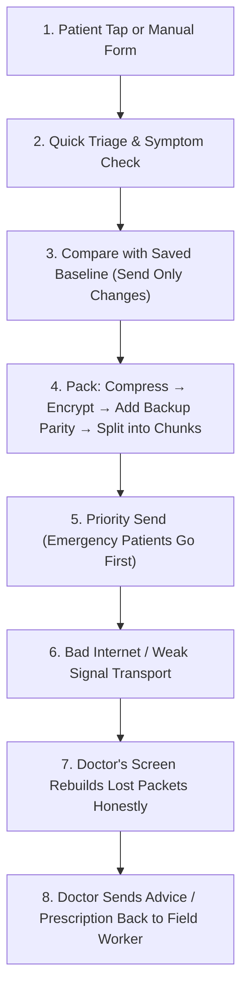

# Namma MedGate

**Namma MedGate** is a mobile app made for doctors and rural healthcare workers. It lets health workers scan a patient's card with their phone and send medical details to hospital doctors—even when the internet is extremely slow, patchy, or cutting out (like rural 2G or satellite).

---

## 📌 Table of Contents
1. [Why We Built This](#-why-we-built-this)
2. [How It Works (Step-by-Step Flow)](#-how-it-works-step-by-step-flow)
3. [Key Features](#-key-features)
4. [How Data Travels (The 5-Step Pipeline)](#-how-data-travels-the-5-step-pipeline)
5. [Smart Design Choices](#-smart-design-choices)
6. [Project Structure](#-project-structure)
7. [How to Run the App](#-how-to-run-the-app)
8. [Running Tests](#-running-tests)

---

## 💡 Why We Built This

In remote villages and disaster areas:
* Internet connections are weak, drop packets, or shut off completely.
* Standard apps send huge JSON data files that fail to load or get stuck.
* When sending fails halfway, data can get mixed up or lost.

**Namma MedGate fixes this:**
* **Works offline & on weak internet**: Uses smart compression and error-fixing codes so data gets through.
* **Instant card tap**: Reads patient cards with NFC in one second, with a simple manual typing option if NFC isn't available.
* **Safe and honest**: Sends only what changed, never guesses missing numbers, and confirms delivery before saving.
* **Two-way doctor replies**: Doctors at the hospital can review the patient and send advice or prescriptions straight back to the field worker.

---

## 🔄 How It Works (Step-by-Step Flow)

Here is the complete journey of a patient visit:



### The 8 Steps in Detail

1. **Patient Intake (NFC or Manual)**:
   * The health worker taps the patient's card against their Android phone.
   * Basic details (Name, Age, Gender, Blood Group, Allergies) and vitals (Blood Pressure, Pulse, Oxygen, Temp) load immediately.
   * If the patient doesn't have a card, the worker can type it into a simple form.

2. **Quick Triage & Symptom Check**:
   * The app asks simple questions across 5 areas (Chest Pain, Stroke/Nerve signs, Breathing trouble, Bleeding/Injury, General illness).
   * If there are danger signs (like severe chest pain or breathing trouble), it automatically marks the case as **Urgent** and picks the right department (like Cardiology or Pulmonology).

3. **Send Only What Changed (Delta Check)**:
   * Instead of sending the full medical record every time, the app checks what changed since the last confirmed visit.
   * If only blood pressure changed, it sends only the new blood pressure numbers. This cuts data size by up to 85%.
   * The new data is marked as **Pending** in local phone storage until the doctor successfully receives it.

4. **Shrink, Lock, and Add Backups**:
   * The app puts data into a compact list without repetitive labels.
   * It shrinks the data using GZIP compression.
   * It locks the data with AES-256 encryption for patient privacy.
   * It creates backup math pieces (parity). If bad internet drops a packet, the receiver can reconstruct the missing piece without asking to re-send.

5. **Priority Queue (Urgent Cases First)**:
   * Emergency patient records jump to the front of the line.
   * Critical vital signs are always sent before heavy pictures.

6. **Weak Signal & Chaos Simulator**:
   * The app has a built-in internet simulator to test real-world village conditions: 2G/EDGE, high packet loss (up to 80%), and delays.

7. **Doctor Review & Image Rebuild**:
   * At the hospital, the doctor's screen receives packets as they arrive.
   * If chunks were lost on the way, the app rebuilds them using the backup parity pieces.
   * If too much was lost to fix, it tells the doctor honestly instead of guessing wrong numbers.
   * Photos (like wounds or rash pictures) are rebuilt tile by tile.

8. **Doctor Replies Back to the Field**:
   * The doctor writes their diagnosis, advice, and medicine orders.
   * This reply travels back using the same protected pipeline.
   * An alert pops up on the field worker's phone.
   * Once confirmed, the record is safely saved into the permanent database.

---

## ✨ Key Features

| Feature | What It Does |
|---|---|
| **NFC Card Scan** | Tap the card on the phone to load or update patient records in one second. |
| **Manual Fallback** | Clean screen to type in details if NFC is turned off or not available. |
| **Symptom Triage** | Checks for red-flag symptoms and routes the patient to the right specialist. |
| **Delta Sync** | Sends only modified numbers, saving precious bandwidth. |
| **Self-Healing Packets** | Uses RAID-style parity math to recover dropped packets without re-transmitting. |
| **Honest Confidence** | Clearly shows if data is 100% recovered, partial, or failed. Never fakes recovery. |
| **Store & Forward** | If connection is lost completely, items wait safely in queue and retry when back online. |
| **Two-Way Chat/Orders** | Doctors can send prescriptions and instructions directly back to the field worker. |
| **Built-in Bad Internet Tester** | Lets you test the app under 10% to 80% packet loss and high latency. |

---

## 📦 How Data Travels (The 5-Step Pipeline)

To make data as small, safe, and tough as possible, every outgoing message follows this exact order:

```
[Patient Data]
      │
      ▼
1. Short Format        --> Removes repetitive field names. Example: "P01|John|45|M|120|80"
      │
      ▼
2. GZIP Shrink         --> Makes the text as small as possible (saves 40-70% size).
      │
      ▼
3. AES-256 Lock        --> Encrypts the shrunken data so nobody can spy on it.
      │
      ▼
4. Backup Math Pieces  --> Creates parity pieces to fix packets that get lost in transit.
      │
      ▼
5. Split into Chunks   --> Breaks data into small bite-sized packets ready for weak signals.
      │
      ▼
 [Sent over Network]
```

---

## 🧠 Smart Design Choices

* **Why compress BEFORE encrypting?**  
  Encrypted data looks completely random. Random data cannot be compressed. By compressing *first*, we shrink the data down before locking it.
* **Why no JSON tags?**  
  Words like `"patient_name"` and `"blood_pressure"` take up most of the bytes. We send values in a fixed position instead, saving huge amounts of data.
* **Why "Compare-Then-Overwrite"?**  
  If a phone sends an update but the internet dies halfway, the phone keeps the old confirmed record safe. It only marks the new record as confirmed once the doctor's screen verifies it.
* **Honest Math, No Guesses:**  
  In healthcare, wrong data is dangerous. If a connection is too broken to rebuild lost pieces, the app says "Recovery Failed — Please Reconnect" rather than showing guessed vitals.

---

## 📁 Project Structure

```
cih_2026-main/
├── lib/
│   ├── core/                  # Shared styling, glass cards, alert banners, and page router
│   │   ├── routing/           # Page navigation
│   │   ├── theme/             # Modern glassmorphism UI theme
│   │   └── widgets/           # Reusable alerts (ClinicalAlert) and badges (StatusPill)
│   ├── features/
│   │   ├── home/              # Main dashboard for health workers
│   │   ├── nfc_capture/       # NFC card reading, card writing, and manual form
│   │   ├── triage/            # 5-domain symptom questionnaire and emergency routing
│   │   ├── transmission_engine/# 5-step pipeline, compression, encryption, and recovery
│   │   ├── network_simulator/ # Internet condition tester (loss %, latency, presets)
│   │   ├── specialist_view/   # Doctor's console, tile reassembly, and reply composer
│   │   └── patient_storage/   # SQLite database with safe compare-then-overwrite rules
│   └── main.dart              # App startup
├── test/                      # 63 automated tests for all features and math
├── Dockerfile                 # For running tests in a clean container
└── AGENTS.md                  # Development rules and coding guidelines
```

---

## 🚀 How to Run the App

### Requirements
* [Flutter SDK](https://docs.flutter.dev/get-started/install) installed (version 3.24 or newer).
* An Android phone, iPhone, or Chrome browser.

### 1. Download and install dependencies
```bash
flutter pub get
```

### 2. Start the app
```bash
flutter run
```

### 3. Quick Tryout
1. Open the app and choose **New Patient Intake**.
2. Tap **Scan NFC Tag** or toggle **Manual Mode** to fill sample vitals.
3. Check some symptoms in **Triage** (like chest pain) to see the emergency flag.
4. Go to **Network Simulator**, turn packet loss up to **40%**, and hit Send.
5. Open the **Specialist View** to watch the packets rebuild and read the patient record.
6. Type a doctor reply and send it back to see the alert on the worker's screen.

---

## 🧪 Running Tests

MedGate includes **63 automated tests** that check everything from data compression to packet recovery and database rules.

Run all tests with:
```bash
flutter test
```

Check code health with:
```bash
flutter analyze
```

Or run everything inside Docker:
```bash
docker compose run medgate-dev flutter test
```
