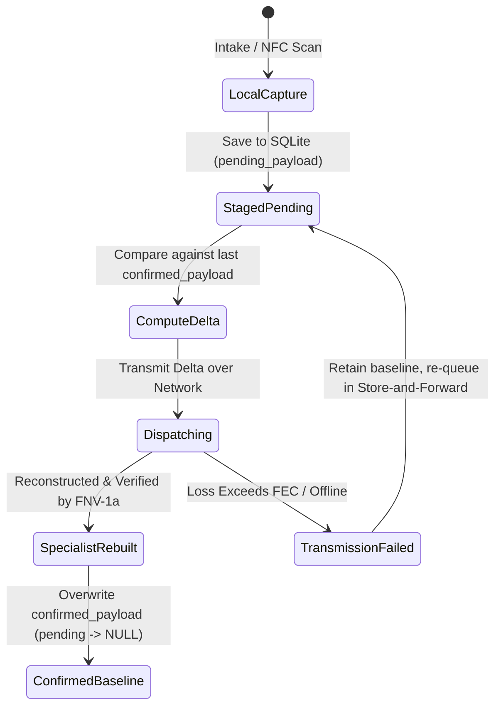

# Namma MedGate

> **Contactless Patient Intake & Resilient Telemedicine Transmission Pipeline**  
> Engineered for rural, resource-constrained, and intermittently connected clinical environments.

---

## 📋 Table of Contents
1. [Overview & Clinical Mission](#-overview--clinical-mission)
2. [End-to-End System Workflow](#-end-to-end-system-workflow)
3. [Architecture & Pipeline Deep Dive](#-architecture--pipeline-deep-dive)
   - [1. Contactless NFC Intake & Manual Fallback](#1-contactless-nfc-intake--manual-fallback)
   - [2. Rule-Based Clinical Triage & Urgency Routing](#2-rule-based-clinical-triage--urgency-routing)
   - [3. Compare-Then-Overwrite Persistence Guarantee](#3-compare-then-overwrite-persistence-guarantee)
   - [4. The 5-Stage Protected Transmission Pipeline](#4-the-5-stage-protected-transmission-pipeline)
   - [5. Store-and-Forward Priority Queue](#5-store-and-forward-priority-queue)
   - [6. Chaos Network Simulator](#6-chaos-network-simulator)
   - [7. Progressive Specialist Review & Tile Reconstruction](#7-progressive-specialist-review--tile-reconstruction)
   - [8. Two-Way Specialist Consultation & Field Alert Loop](#8-two-way-specialist-consultation--field-alert-loop)
4. [Engineering Principles & Design Decisions](#-engineering-principles--design-decisions)
5. [System Architecture & Directory Structure](#-system-architecture--directory-structure)
6. [Tech Stack & Dependencies](#-tech-stack--dependencies)
7. [Getting Started & Local Setup](#-getting-started--local-setup)
8. [Testing & Verification](#-testing--verification)

---

## 🌟 Overview & Clinical Mission

In rural health outposts, primary health centers (PHCs), and disaster-relief zones, community health workers (ASHA/ANM) face two major technical barriers:
1. **Inefficient, error-prone manual intake** in high-throughput triage settings.
2. **Severely degraded network infrastructure** (high packet loss, 2G/EDGE speeds, satellite jitter, and complete blackouts) that causes standard HTTP/JSON and WebRTC telemedicine payloads to fail entirely.

**Namma MedGate** bridges this gap. It pairs **contactless NFC patient intake** with a custom **forward-error-correcting (FEC), delta-compressed, encrypted transmission pipeline**. The system guarantees patient data integrity across adverse channels, provides mathematical reconstruction with uncompromised honesty, and enables a closed-loop, two-way tele-consultation between frontline workers and remote hospital specialists.

---

## 🔄 End-to-End System Workflow

The patient care lifecycle follows an 8-stage pipeline from frontline capture to remote specialist assessment and return diagnosis:

```mermaid
flowchart TD
    %% Intake & Triage
    subgraph S1["1. Frontline Intake & Triage"]
        A["NFC Card Tap / Manual Form"] --> B["Patient Model & Vitals"]
        B --> C["Rule-Based Triage Assessment"]
        C --> D{"Urgency & Specialty Evaluator"}
        D -->|Urgent Flag / High Risk| E["Priority Flag Assigned"]
        D -->|Routine| F["Standard Flag Assigned"]
    end

    %% Persistence & Delta Engine
    subgraph S2["2. Delta Engine & Local Storage"]
        E & F --> G["Compare with Last Confirmed Baseline"]
        G --> H["Compute Delta Fields Only"]
        H --> I[("Stage Local Capture as 'PENDING' in SQLite")]
    end

    %% Transmission Engine
    subgraph S3["3. Transmission Pipeline"]
        I --> J["Positional Tuple Encoding (No JSON Keys)"]
        J --> K["Max-Level GZIP / DEFLATE Compression"]
        K --> L["AES-256-CBC Payload Encryption"]
        L --> M["XOR / Reed-Solomon Parity Redundancy Generation"]
        M --> N["Chunking Engine (Optional Rust FFI / Pure Dart)"]
    end

    %% Network & Transport
    subgraph S4["4. Transport & Chaos Simulation"]
        N --> O["Store-and-Forward Priority Queue"]
        O -->|Urgent Vitals First| P["Channel Simulator (Loss, Latency, Jitter)"]
        P -->|Independent Per-Chunk Loss Rolls| Q["Degraded Transport Channel"]
    end

    %% Specialist Review
    subgraph S5["5. Specialist Reassembly & Verification"]
        Q --> R["Progressive Chunk Assembly"]
        R --> S["FEC Parity Erasure Recovery"]
        S --> T{"Loss <= Parity Capacity?"}
        T -->|Yes| U["Payload Rebuilt + FNV-1a Checksum Matched"]
        T -->|No| V["Partial / Failed Recovery Flagged Honestly"]
        U --> W["Specialist Clinical Console (Vitals, Image Tiles, History)"]
    end

    %% Two-Way Tele-Consultation
    subgraph S6["6. Two-Way Consultation Loop"]
        W --> X["Doctor Review & Prescriptions / Orders"]
        X --> Y["Encrypted Reply Transmission Pipeline"]
        Y --> Z["Health Worker Dashboard Alert"]
        Z --> AA[("Overwrite Pending Record to Confirmed Baseline in SQLite")]
    end
```



---

## 🔬 Architecture & Pipeline Deep Dive

### 1. Contactless NFC Intake & Manual Fallback
- **NFC Tag Emulation & Scanning**: Reads standardized NDEF records containing encrypted or positional patient schema data from smart health cards using `nfc_manager`.
- **Zero-Latency Read**: Instantly populates demographics (MedGate ID, age, gender code, blood group), baseline vitals (systolic/diastolic BP, pulse, SpO2, respiratory rate, temperature), and allergy arrays.
- **Fail-Safe Manual Fallback**: When NFC hardware is unavailable or permissions are denied, an intuitive manual input form with glassmorphic cards provides quick entry with clinical plausibility validation.
- **Bi-Directional Card Writeback**: Health workers can write updated triage records and prescriptions back to the physical NFC tag for patient mobility.

### 2. Rule-Based Clinical Triage & Urgency Routing
To ensure deterministic, audit-proof, and explainable emergency handling without unverified AI hallucinations, MedGate implements a formal clinical assessment matrix:
- **Symptom Questionnaire Across 5 Vital Domains**:
  1. *Cardiovascular / Chest Pain* (radiation, crushing pressure, diaphoresis)
  2. *Neurological / Stroke* (facial droop, arm weakness, speech slurring, acute confusion)
  3. *Respiratory* (severe dyspnea, stridor, accessory muscle usage, cyanosis)
  4. *Trauma & Hemorrhage* (uncontrolled bleeding, compound fractures, head trauma)
  5. *General & Infectious* (high fever, severe dehydration, lethargy)
- **Specialty Routing Engine**: Automatically classifies and routes the payload to the appropriate on-call hospital department (`Cardiology`, `Neurology`, `Pulmonology`, `Trauma Surgery`, or `General Medicine`).
- **Urgency Propagation**: An urgent intake triggers priority queue preemption, bypasses background payloads, and forces accelerated fallback thresholds across the entire network stack.

### 3. Compare-Then-Overwrite Persistence Guarantee
To prevent network drops or partial transfers from corrupting local baselines, MedGate enforces a **strict transactional state machine**:



1. **Staged Local Capture**: New vitals and intake updates are initially written to `pending_raw_encoded_value` in SQLite while leaving `raw_encoded_value` intact.
2. **Delta Encoding**: MedGate compares the capture against the database-confirmed baseline (not just the in-memory UI state) and serializes *only fields that changed*, reducing transmission footprint by up to 85%.
3. **Confirmed Overwrite**: The confirmed baseline is updated **if and only if** specialist-side reconstruction is cryptographically verified. If transmission fails, the previous known-good baseline is preserved for the next retry.

### 4. The 5-Stage Protected Transmission Pipeline
MedGate's byte-budgeted transmission pipeline operates in strict sequential order:

```
[Raw Patient Record / Delta]
            │
            ▼
┌───────────────────────────────────────┐
│ Stage 1: Positional Tuple Encoding    │  Zero JSON keys; compact schema format
└───────────────────────────────────────┘
            │
            ▼
┌───────────────────────────────────────┐
│ Stage 2: Max-Level GZIP / DEFLATE     │  Applied BEFORE encryption for real shrinkage
└───────────────────────────────────────┘
            │
            ▼
┌───────────────────────────────────────┐
│ Stage 3: AES-256-CBC Encryption       │  Secures compressed payload + IV prepended
└───────────────────────────────────────┘
            │
            ▼
┌───────────────────────────────────────┐
│ Stage 4: Erasure Redundancy (FEC)     │  XOR/Reed-Solomon style parity blocks
└───────────────────────────────────────┘
            │
            ▼
┌───────────────────────────────────────┐
│ Stage 5: Chunking & Packaging         │  Fixed MTU packets (Rust FFI or pure Dart)
└───────────────────────────────────────┘
            │
            ▼
   [Network Dispatch]
```

- **Stage 1 (Positional Tuple Encoding)**: Standard JSON structures waste 60–75% of bandwidth on repeated field names. MedGate converts models to index-positioned tuple strings (`ID|NAME|AGE|SEX|BP_S|BP_D|HR|SPO2|TEMP|TRIAGE_CODE...`), discarding schema overhead.
- **Stage 2 (Pre-Encryption GZIP Compression)**: Max-level DEFLATE is executed **before** encryption. Encrypted data has maximal entropy and cannot be compressed; compressing first achieves typical size reductions of 40–70%.
- **Stage 3 (AES-256 Encryption)**: Secures medical data in transit using AES-256 with dynamic initialization vectors (IV) adhering to HIPAA/DISHA guidelines.
- **Stage 4 (Erasure Coding / Parity Redundancy)**: Generates RAID 5-style XOR parity groups across packet chunks. A redundancy setting of $R$ allows mathematical reconstruction of up to $K$ missing chunks per group without retransmission.
- **Stage 5 (Chunking & Packaging)**: Slices encrypted data into discrete transport packets tagged with sequence numbers, group indices, and FNV-1a checksums.

### 5. Store-and-Forward Priority Queue
- **Urgency-First Scheduling**: The internal queue sorts pending items such that urgent triage assessments and critical vitals jump to the front of the queue, preceding non-urgent visits and large diagnostic image chunks.
- **Exponential Backoff & Re-queueing**: Interrupted transfers automatically pause without dropping packets, re-evaluating connection viability and retrying when the channel recovers.

### 6. Chaos Network Simulator
A built-in laboratory network engine enables live chaos-testing directly inside the app:
- **Independent Random Loss**: Uses independent, non-deterministic random rolls per chunk (no artificial cyclic patterns), accurately mimicking packet drop spikes.
- **Tunable Parameters**:
  - *Packet Loss*: 0% to 80% loss rates.
  - *Latency / Delay*: 0 ms to 4000 ms.
  - *Redundancy Multiplier*: 0% to 100% parity ratio.
  - *Bandwidth Throttling*: Emulates EDGE/2G, High-Loss Satellite, Intermittent Dropout, or Complete Blackout.
- **Live Telemetry Instrumentation**: Tracks source size, compressed size, chunks transmitted, chunks dropped, chunks reconstructed, FNV-1a match, and transit time.

### 7. Progressive Specialist Review & Tile Reconstruction
- **Real-Time Chunk Stream**: As packets arrive at the hospital specialist console, progress bars and packet matrix grids visualize surviving vs. parity-recovered chunks.
- **Honest Confidence Score**: The reconstruction engine calculates a mathematically honest confidence score based on actual recovered blocks:
  $$\text{Confidence} = \frac{\text{Surviving Chunks} + \text{Parity-Recovered Chunks}}{\text{Total Required Chunks}} \times 100\%$$
  If packet loss exceeds parity capacity, MedGate reports **Partial** or **Failed Recovery** rather than fabricating unverified data.
- **Image Tile Erasure Recovery**: Diagnostic medical images (e.g., wound photos, ECG strips) are sliced into 2D tiles and processed through the FEC pipeline. The specialist workstation displays corrupted raw tiles alongside parity-reconstructed tiles with real recovery metrics.

### 8. Two-Way Specialist Consultation & Field Alert Loop
1. **Specialist Response**: The doctor reviews the recovered vitals, triage classification, and image tiles, entering preliminary diagnosis, triage approval, medication orders, and advice.
2. **Reverse Protected Pipeline**: The doctor's consultation reply is encoded, compressed, encrypted, and chunked through the same resilient transport engine.
3. **Field Health Worker Alert**: When the phone receives the reply, it triggers a `ClinicalAlert` notification banner on the frontline worker's terminal.
4. **Permanent Baseline Sync**: The health worker verifies the specialist's notes, which triggers `ConsultationReplyStore` to commit the reply and confirm the patient record in local SQLite storage.

---

## 💡 Engineering Principles & Design Decisions

| Decision | Rationale |
|---|---|
| **Compress Before Encrypt** | Ciphertext has near-maximal entropy and cannot be compressed. Performing GZIP *first* reduces payload volume by up to 70% before encryption. |
| **Positional Tuples over JSON** | Key names (`"systolic_bp"`, `"patient_name"`) repeat on every transmission. Positional index mapping reduces baseline payload size to bare bytes. |
| **Compare-Then-Overwrite** | Rural networks drop mid-transfer. Overwriting baselines only upon verified specialist receipt prevents state desynchronization. |
| **No Fabricated Confidence** | If packet loss exceeds parity threshold, the system displays honest failure and prompts reconnection rather than guessing critical vitals. |
| **Dual Engine: Rust FFI + Pure Dart** | High-performance CPU chunking via compiled Rust FFI with zero-dependency pure Dart fallback ensures universal compatibility on any machine. |
| **Strict UI Guardrails** | All notifications use `ClinicalAlert`; all priority and network badges use `StatusPill`. No custom snackbars or ad-hoc chips. |

---

## 📂 System Architecture & Directory Structure

```
cih_2026-main/
├── lib/
│   ├── core/                               # Cross-cutting foundational modules
│   │   ├── constants/                      # Clinical thresholds & global constants
│   │   ├── providers/                      # Core alert & navigation providers
│   │   ├── routing/                        # GoRouter routing table & page transitions
│   │   ├── theme/                          # Glassmorphism design tokens & styles
│   │   └── widgets/                        # Shared ClinicalAlert, StatusPill, Glass widgets
│   ├── features/                           # Feature-first domain modules
│   │   ├── auth/                           # Authentication & session controls
│   │   ├── data/                           # PatientModel & Positional PatientSchema
│   │   ├── debug/                          # Component gallery & UI playground
│   │   ├── home/                           # Main frontline worker dashboard
│   │   ├── network_simulator/              # Chaos simulation controls & channel states
│   │   ├── nfc_capture/                    # NFC card reading, writing, & manual fallback
│   │   ├── onboarding/                     # First-run clinical role selection
│   │   ├── patient_storage/                # SQLite compare-then-overwrite databases
│   │   ├── settings/                       # Network, redundancy, & storage settings
│   │   ├── specialist_view/                # Specialist progressive review & image console
│   │   ├── transmission_engine/            # 5-stage pipeline, FEC parity, & priority queue
│   │   └── triage/                         # 5-domain symptom questionnaire & routing
│   └── main.dart                           # Application entry point
├── native/                                 # Optional Rust native FFI acceleration
│   └── src/                                # High-speed XOR parity chunking engine
├── test/                                   # 63 unit, widget, and end-to-end integration tests
│   ├── adaptive_transmission_test.dart
│   ├── chunking_test.dart
│   ├── clinical_alert_test.dart
│   ├── consultation_reply_test.dart
│   ├── image_recovery_test.dart
│   ├── nfc_provider_test.dart
│   ├── patient_record_store_test.dart
│   ├── patient_schema_test.dart
│   ├── status_pill_test.dart
│   ├── transmission_engine_test.dart
│   ├── transmission_flow_test.dart
│   ├── triage_assessment_test.dart
│   └── widget_test.dart
├── Dockerfile                              # Containerized build environment
├── docker-compose.yml                      # Hermetic test & analysis runner
├── pubspec.yaml                            # Package dependencies & assets
└── AGENTS.md                               # Architectural and clinical guardrails
```

---

## 🛠 Tech Stack & Dependencies

- **Framework**: [Flutter](https://flutter.dev/) (Channel stable, Dart 3.x)
- **State Management**: [Riverpod](https://riverpod.dev/) (`flutter_riverpod`)
- **Navigation**: [GoRouter](https://pub.dev/packages/go_router)
- **Compression**: `archive` (Max-level GZIP / DEFLATE)
- **Cryptography**: `encrypt` & `pointycastle` (AES-256-CBC, secure random IV generation)
- **Integrity**: `crypto` (FNV-1a checksums & field-level SHA hashing)
- **Local Persistence**: `sqflite` / `sqflite_common_ffi` (Compare-then-overwrite SQLite engine)
- **Hardware Integration**: `nfc_manager` (NDEF tag reading and writing)
- **Image Processing**: `flutter_image_compress` (Diagnostic tile compression)
- **UI & Animations**: `flutter_animate`, `google_fonts`, glassmorphic custom shaders

---

## 🚀 Getting Started & Local Setup

### Prerequisites
- [Flutter SDK](https://docs.flutter.dev/get-started/install) (>= 3.24.0)
- Dart SDK (>= 3.5.0)
- (Optional) [Rust toolchain](https://rustup.rs/) if building native FFI binaries (otherwise automatic Dart fallback is used).

### 1. Clone & Fetch Dependencies
```bash
git clone https://github.com/ajitrloni27/MaciF.git
cd MaciF
flutter pub get
```

### 2. Run the App
To launch on Chrome, desktop, or a connected Android/iOS mobile device:
```bash
flutter run
```

### 3. Quickstart Demo Walkthrough
1. **Home Screen**: Select **New Patient Intake**.
2. **Intake / NFC**: Tap **Scan NFC Tag** or toggle **Manual Mode** to fill sample patient vitals.
3. **Triage Assessment**: Select patient symptoms (e.g., Chest Pain + Diaphoresis) to see real-time Emergency/Urgent triage flags and Cardiology auto-routing.
4. **Network Simulator**: Navigate to **Network Simulator**, set packet loss to **40%**, and latency to **800 ms**.
5. **Transmit & Verify**: Send the record. Watch the transmission pipeline compress, encrypt, and chunk the payload.
6. **Specialist Console**: Switch to the **Specialist View** to observe progressive reassembly, parity packet recovery, and FNV-1a checksum confirmation.
7. **Doctor Reply**: Compose a specialist prescription, send it back, and observe the `ClinicalAlert` notification and SQLite baseline overwrite on the frontline terminal.

---

## 🧪 Testing & Verification

The project includes **63 automated tests** covering the entire lifecycle from hardware abstraction to cryptographic pipeline and erasure math:

### Run Full Test Suite
```bash
flutter test
```

### Run Static Analysis
```bash
flutter analyze
```

### Run Hermetic Tests in Docker
For a clean, containerized test run without local dependency differences:
```bash
docker compose build
docker compose run medgate-dev flutter test
```

---

## 📜 Compliance & Clinical Guardrails
Development strictly adheres to the architectural rules defined in [`AGENTS.md`](AGENTS.md):
- Keep business logic isolated in providers and logic files.
- Compress payloads prior to encryption.
- Maintain independent per-chunk loss rolls in the network simulator.
- Uphold the compare-then-overwrite rule for local patient storage.
- Standardize all visual indicators on `StatusPill` and all alerts on `ClinicalAlert`.
